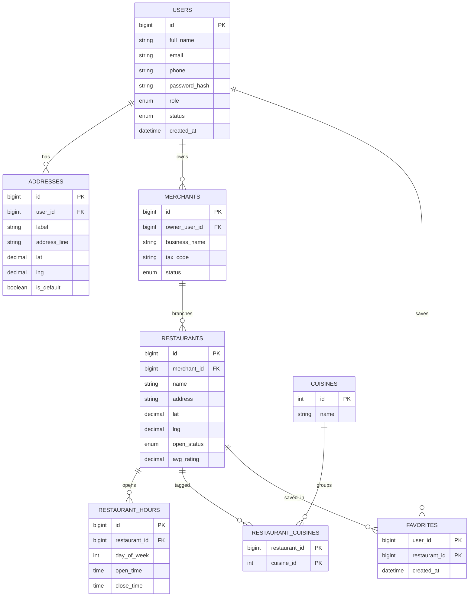
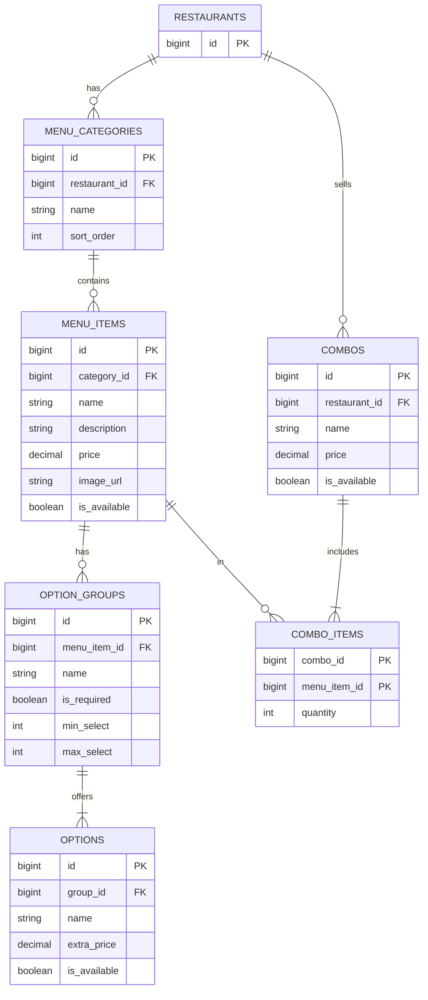
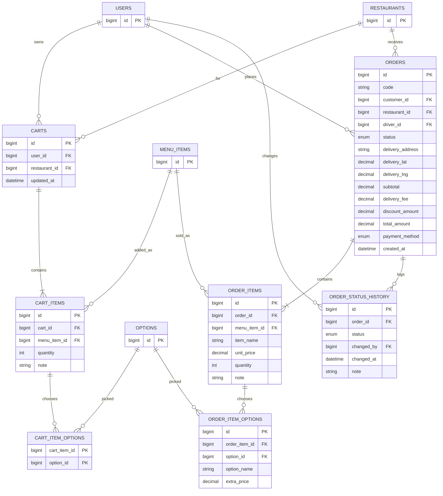
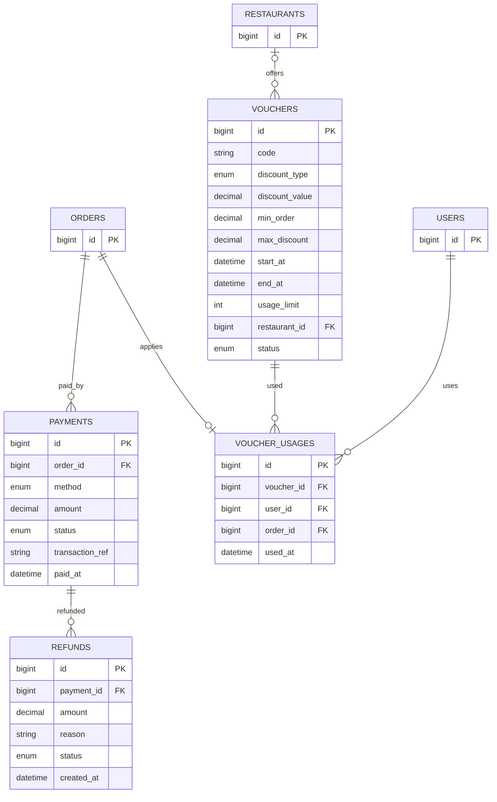
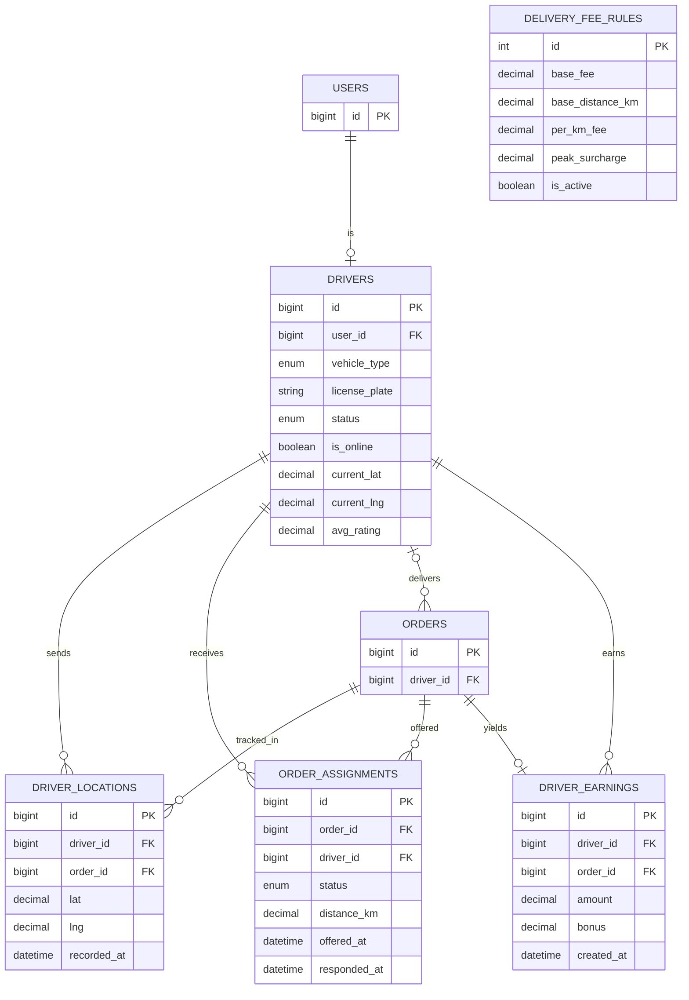
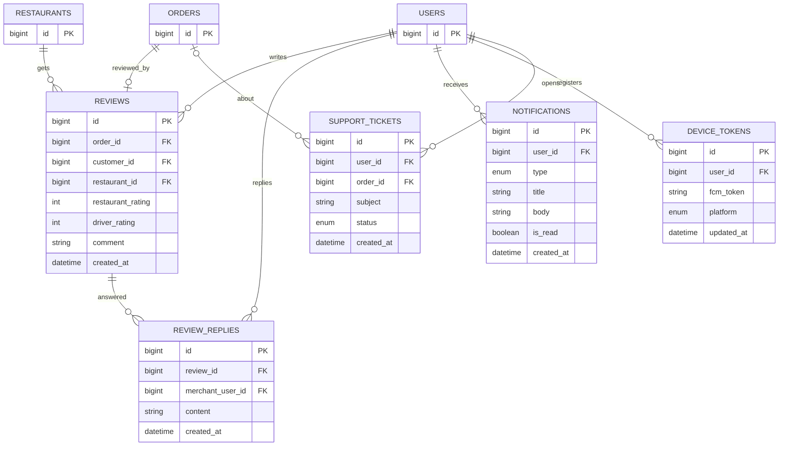
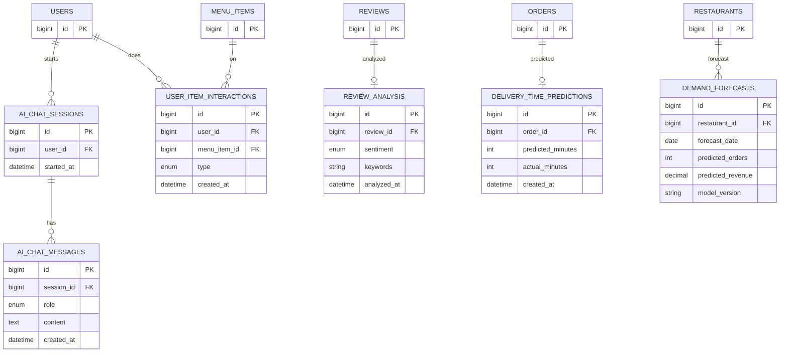

# Sơ đồ ERD

Chỉ ghi khóa chính, khóa ngoại và các cột chính. Đủ cột nằm trong `V1__init.sql`. Bảng nào thuộc nhóm khác chỉ hiện `id` để làm điểm nối.

## 1. Tài khoản và cửa hàng

## 2. Thực đơn

## 3. Giỏ hàng và đơn hàng

## 4. Thanh toán và khuyến mãi

## 5. Tài xế và giao hàng

## 6. Đánh giá, thông báo, hỗ trợ

## 7. Bảng phục vụ AI

